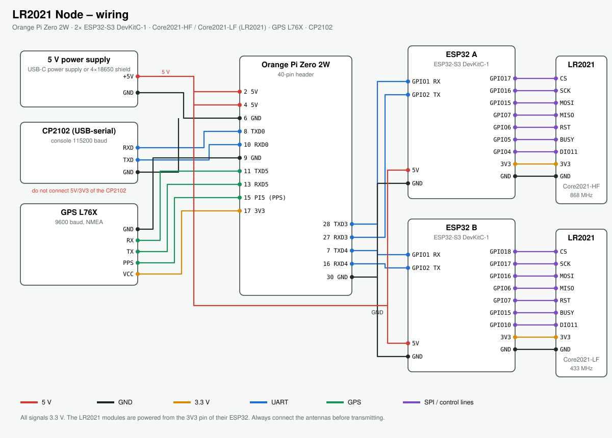

# LR2021 Node

**A self-built LoRa mesh node with two Semtech LR2021 radios** (868 MHz + 433 MHz, both also 2.4 GHz).
It speaks **Meshtastic**, listens to **MeshCore** and has its own amateur-radio protocol for
text, images and files. Controlled by an app for Android, iOS, Windows and Linux – over Wi-Fi, Bluetooth,
USB or a serial cable.

## Hardware

| Part | Role |
|---|---|
| Orange Pi Zero 2W | the brain: runs the node service, Wi-Fi hotspot, Bluetooth, web UI |
| 2× ESP32-S3 DevKitC-1 | radio modems, one per LR2021 |
| Waveshare Core2021-HF / -LF (LR2021) | 850–930 MHz and 410–510 MHz, plus 2.4 GHz |
| GPS L76X | position |
| CP2102 | serial console / cable connection to the PC app |

Full part list: [docs/hardware/parts-list.md](docs/hardware/parts-list.md) ·
assembly and wiring: [docs/hardware/assembly.md](docs/hardware/assembly.md)

## Software

| Folder | Content | Docs |
|---|---|---|
| `firmware/` | ESP32 modem firmware (Arduino, RadioLib) | [docs/firmware.md](docs/firmware.md) |
| `Node/` | SD card image for the Orange Pi (Armbian), node service `lr2021d` | [docs/node.md](docs/node.md) |
| `App/source/` | Flutter app (Android, iOS, Windows, Linux) | [docs/app.md](docs/app.md) |
| `host/`, `modem_tool.py` | Python tools for testing modems on a PC | [docs/firmware.md](docs/firmware.md) |
| `docs/modem-protocol.md` | serial protocol between node and modems | – |

## Download

Ready-to-use builds are in the [releases](../../releases/latest): app for Android, iOS, Windows and Linux,
both modem firmwares and the node update package. The app updates itself from there.

## Building a node

1. Get the parts ([part list](docs/hardware/parts-list.md)) and wire them ([assembly](docs/hardware/assembly.md)).
2. Flash `LR2021-Modem-A.bin` to ESP32 A and `LR2021-Modem-B.bin` to ESP32 B ([firmware](docs/firmware.md)).
3. Build and write the SD card image ([node](docs/node.md)).
4. Install the app, connect to the node's Wi-Fi `LR2021-xxxx` and pick “Network (Pi)” ([app](docs/app.md)).

Transmitting on 70 cm with full power and the own LR protocol requires an amateur radio licence.
The app enforces the legal power limits for the license-free bands.

## Documentation

- Part list: [docs/hardware/parts-list.md](docs/hardware/parts-list.md)
- Assembly and wiring: [docs/hardware/assembly.md](docs/hardware/assembly.md)
- ESP32 firmware: [docs/firmware.md](docs/firmware.md)
- Node software (SD card): [docs/node.md](docs/node.md)
- App: [docs/app.md](docs/app.md)
- Modem protocol: [docs/modem-protocol.md](docs/modem-protocol.md)
- Transmit power and licence: [docs/tx-power.md](docs/tx-power.md)

## License

- Software and firmware: **GPL-3.0** ([LICENSE](LICENSE))
- Hardware documentation (wiring, part list, plans): **CERN-OHL-S-2.0** ([LICENSE-HARDWARE](LICENSE-HARDWARE))
- **Attribution required:** see [NOTICE](NOTICE).

© 2026 Raviolimeister (RAV1805)

