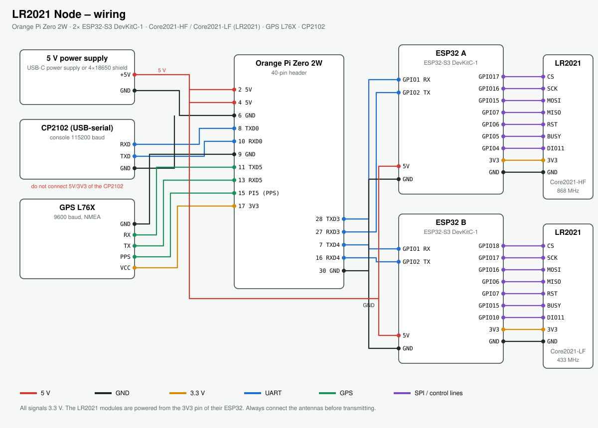

# Assembly and wiring



The diagram is generated from the tables below with `python3 wiring.py`. All signals use 3.3 V.
Parts: see [parts-list.md](parts-list.md).

## Overview

```
                 ┌──────────── UART3 (500000) ──── ESP32 A ── SPI ── LR2021 (Core2021-HF, 868 MHz)
 5 V power ── Orange Pi Zero 2W
                 ├──────────── UART4 (500000) ──── ESP32 B ── SPI ── LR2021 (Core2021-LF, 433 MHz)
                 ├──────────── UART5 (9600) ────── GPS L76X
                 └──────────── UART0 (115200) ──── CP2102 ── USB ── PC
```

The two ESP32 are pure radio modems: they drive their LR2021 and carry out what the Orange Pi tells
them. Meshtastic, MeshCore and the own LR radio protocol run in the software on the Pi or in the app –
the ESP32 never need to be re-flashed for that.

## Orange Pi Zero 2W – pin header

| Pi pin | Signal | Linux | Connected to |
|---|---|---|---|
| 2, 4 | 5 V | – | power supply (J1), 5V pin of both ESP32 |
| 6 | GND | – | power supply (J1), GND of the CP2102 |
| 8 | UART0 TX | ttyS0 | CP2102 **RXD** |
| 10 | UART0 RX | ttyS0 | CP2102 **TXD** |
| 9 | GND | – | GPS GND |
| 11 | UART5 TX | ttyS5 | GPS **RX** |
| 13 | UART5 RX | ttyS5 | GPS **TX** |
| 15 | PI5 | – | GPS PPS (optional) |
| 17 | 3.3 V | – | GPS VCC |
| 28 | UART3 TX | ttyS3 | ESP32 A **GPIO1** (RX) |
| 27 | UART3 RX | ttyS3 | ESP32 A **GPIO2** (TX) |
| 7 | UART4 TX | ttyS4 | ESP32 B **GPIO1** (RX) |
| 16 | UART4 RX | ttyS4 | ESP32 B **GPIO2** (TX) |
| 30 | GND | – | GND of both ESP32 |

On the CP2102 connect only **TXD, RXD and GND**. Leave its 5 V / 3.3 V pin unconnected, otherwise the
PC's supply and the node's supply meet.

## ESP32 ↔ LR2021

| Signal on the LR2021 | ESP32 A (Core2021-HF) | ESP32 B (Core2021-LF) |
|---|---|---|
| NSS / CS | GPIO17 | GPIO18 |
| SCK | GPIO16 | GPIO17 |
| MOSI | GPIO15 | GPIO16 |
| MISO | GPIO7 | GPIO6 |
| NRESET | GPIO6 | GPIO7 |
| BUSY | GPIO5 | GPIO15 |
| DIO11 (IRQ) | GPIO4 | GPIO10 |
| VCC | 3V3 | 3V3 |
| GND | GND | GND |

The pin assignment is defined in `firmware/lr2021_modem/config.h`. That is why there are two firmware
files (A and B), which must **not be swapped**.

Other ESP32 pins: GPIO1 = RX from the Pi, GPIO2 = TX to the Pi, GPIO48 = RGB LED (on the DevKit).

## Power supply

- The node runs on 5 V: either a USB-C power supply on the Orange Pi or the battery shield via J1 to
  pins 2/4 and 6.
- The ESP32 get 5 V on their **5V pin** from the same rail; their 3V3 regulator supplies the LR2021.
- Connect only **one** 5 V source at a time. If an ESP32 is flashed over USB from a PC while the node
  is on a power supply, the two sources can interfere – disconnect the node from its supply for
  flashing, or flash through the node (see [firmware](../firmware.md)).

## Assembly order

1. Place and solder the sockets for the Orange Pi, the ESP32 and the LR2021 modules on the perfboard.
2. Ground first: Pi pin 6/9/30, GND of the ESP32, LR2021, GPS, CP2102.
3. 5 V: J1 → Pi pin 2/4 → 5V pin of the ESP32. 3.3 V: ESP32 3V3 → LR2021 VCC, Pi pin 17 → GPS VCC.
4. SPI and control lines ESP32 ↔ LR2021 according to the table; keep the wires short.
5. UART lines Pi ↔ ESP32, GPS and CP2102 (TX always to RX).
6. Before powering up the first time: check with a multimeter for shorts between 5 V, 3.3 V and GND.
7. Screw on the antennas, then insert the SD card and power up.

## First test

- Red power LED on both ESP32, RGB LED briefly blue, then dimmed blue (receiving).
- RGB LED permanently red: the LR2021 does not respond → check the SPI lines, BUSY, RESET and 3.3 V.
- The node's web interface (`http://10.42.0.1` in the node's Wi-Fi) shows both modems as connected
  and the GPS.
