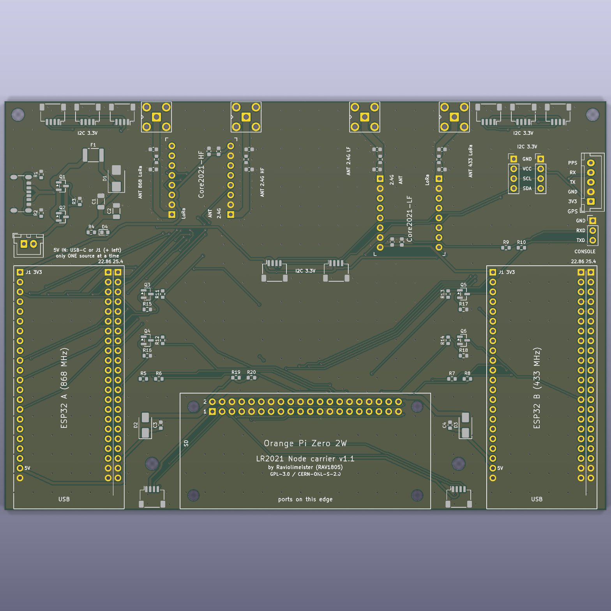

# LR2021 Node – carrier board

A 156 × 106 mm two-layer PCB that replaces the perfboard and the point-to-point wiring. All modules
stay pluggable: the Orange Pi Zero 2W, both ESP32-S3 DevKitC-1 and both Core2021 modules sit in
female headers with generous space between them. The four antenna connectors are soldered to the
board, and the small SMD parts can be assembled by the PCB manufacturer.



> Revision 1.1 has not been manufactured yet. Before ordering, print `fabrication/layout.svg` at
> 100 % and check the header positions against your own modules.

## Layout

```
 top edge:   I2C I2C I2C   [868 LoRa]  [2.4G HF]        [2.4G LF]  [433 LoRa]   I2C I2C I2C
             USB-C / J1    Core2021-HF                  Core2021-LF             I2C  GPS
             power input                                                        console
             ESP32 A                     I2C   I2C                              ESP32 B
             (USB at the                                                        (USB at the
              bottom edge)       Orange Pi Zero 2W (ports at the bottom edge)    bottom edge)
                          I2C                                              I2C
```

## Features

- **Four SMA antenna connectors (90°, through hole) on the top edge:** 868 MHz LoRa on the left,
  433 MHz LoRa on the right, the two 2.4 GHz connectors in the middle.
  - **RF lines:** each module pin is connected to its connector by a short 50 Ω line (grounded
    coplanar waveguide: 1.55 mm track, 0.3 mm gap, solid ground underneath, ground via fence on
    both sides; calculated for the standard 1.6 mm FR4 two-layer stack). No other signal crosses
    or runs underneath an RF line.
  - **Filter places:** every RF line has a π network close to the connector: the series 0 Ω
    resistor is fitted, the two shunt places (0603) stay empty. A low-pass or matching network can
    be added later. External cavity filters screw directly onto the SMA connector.
- **Ten Qwiic / STEMMA QT sockets plus two 4-pin headers for I²C peripherals** (display, buttons,
  switches, sensors, I/O expanders). All of them are on the same bus: Orange Pi pins 3 (SDA) and
  5 (SCL), 4.7 kΩ pull-ups to 3.3 V. **3.3 V only:** do not connect modules that pull SDA/SCL up
  to 5 V.
- **One protected 5 V input:** USB-C (power only) or JST-XH J1 for the 18650 battery shield, with
  reverse-polarity protection (2 × P-MOSFET), 3 A resettable fuse, TVS diode and a power LED.
- **No back-feeding:** each ESP32 gets its 5 V through a Schottky diode, so a PC on the ESP32's USB
  port cannot feed the node's 5 V rail. All UART lines between the modules and to the console
  have 1 kΩ series resistors, so nothing is powered through the data lines when only one side
  is switched on. The console connector has no supply pin.
- **ESP32 reset and boot from the Orange Pi:** the Pi can pull EN and GPIO0 of each ESP32 low via
  a MOSFET (Pi pins 29/31 = EN/GPIO0 of ESP32 A, pins 32/33 = EN/GPIO0 of ESP32 B; high = pulled
  low). Pull-down resistors keep the ESP32 running while the Pi boots.
- **LR2021 DIO7 and DIO8** are connected to GPIO8 and GPIO9 of both ESP32 (not used by the
  current firmware, reserved).
- Decoupling capacitors at both radio modules, GPS connector with PPS, ground planes on both
  layers.

## Radio modules: antenna signal on the pins

The Core2021 has an IPEX socket and, in parallel, the antenna signal on pin 1 (2.4 GHz) and
pin 16 (LoRa) – but only if the 0 Ω resistors R2 (2.4 GHz) and R3 (LoRa) next to the IPEX
sockets on the module are fitted. Check it with a multimeter: pin 16 to the centre contact of the
LoRa IPEX socket, and pin 1 to the centre contact of the 2.4 GHz socket, must read about 0 Ω. If
not, bridge R2/R3 with a 0402 0 Ω resistor or a solder bridge. Leave the IPEX sockets empty.

## Ordering (e.g. JLCPCB)

1. Upload `fabrication/lr2021-carrier-gerber.zip`. Settings: 2 layers, **1.6 mm**, 1 oz copper,
   FR4, any colour, HASL or ENIG. (The RF line width is calculated for this stack-up.)
2. For assembly: enable "PCB Assembly", top side, upload `fabrication/bom.csv` and
   `fabrication/cpl.csv`. The SMA connectors are through-hole parts – choose the option that
   includes through-hole assembly, or solder them yourself. Check the parts preview: diodes
   (D1–D4), transistors (Q1–Q6), the Qwiic sockets and the SMA connectors must match the marks on
   the board; correct the rotation there if needed.
3. The remaining through-hole parts are soldered by hand, see `fabrication/hand-solder.csv`.

## Assembly

| Position | Part | Note |
|---|---|---|
| U1 / U2 | 2 × female header 1×22 each | ESP32 A / B, USB connectors at the bottom edge. The inner row has two positions: **22.86 mm** (original Espressif DevKitC-1) and **25.4 mm** (many N16R8 boards). Measure the distance between the pin rows of your board and solder the header into the matching row. |
| U3 | 2 × female header 1×8 | Core2021-**HF** (868 MHz), IPEX sockets pointing down |
| U4 | 2 × female header 1×8 | Core2021-**LF** (433 MHz), IPEX sockets pointing up |
| U5 | female header 2×20 | Orange Pi Zero 2W: solder the 2×20 male header to the **underside** of the Pi, then plug it in component side up; the ports face the bottom edge |
| J13–J16 | SMA jack 90°, through hole | antennas: J13 868 MHz, J14 2.4 GHz (HF), J15 2.4 GHz (LF), J16 433 MHz |
| J1 | JST-XH 2-pin | 5 V input from the battery shield (+ on the left) |
| J2 | JST-XH 5-pin | GPS: 3V3, GND, TX, RX, PPS – labels = pins of the GPS module (GPS TX to “TX”) |
| J3 | pin header 1×3 | console: GND, RXD, TXD – labels = pins of the USB serial adapter (adapter RXD to “RXD”); no supply pin |
| J4, J12 | pin header 1×4 | I²C: GND, VCC (3.3 V), SCL, SDA |
| J6–J11, J17–J20 | JST SH 4-pin (Qwiic) | I²C: GND, 3.3 V, SDA, SCL (assembled) |

**Only one 5 V source at a time:** USB-C on the board, J1, or the Pi's own USB-C. Never transmit
without an antenna on the connector of the active band.

## Signals

| Signal | Orange Pi pin | ESP32 / module |
|---|---|---|
| UART3 TX / RX (500000 Bd) | 28 / 27 | ESP32 A GPIO1 / GPIO2 |
| UART4 TX / RX (500000 Bd) | 7 / 16 | ESP32 B GPIO1 / GPIO2 |
| UART5 TX / RX (9600 Bd) | 11 / 13 | GPS RX / TX, PPS on pin 15 |
| UART0 TX / RX (console) | 8 / 10 | J3 |
| I²C SDA / SCL | 3 / 5 | J4, J12, all Qwiic sockets |
| EN / GPIO0 ESP32 A | 29 / 31 | via MOSFET, high = low on the ESP32 |
| EN / GPIO0 ESP32 B | 32 / 33 | via MOSFET, high = low on the ESP32 |

ESP32 ↔ LR2021 as in [assembly.md](../../docs/hardware/assembly.md), plus DIO7 → GPIO8 and
DIO8 → GPIO9.

## Files

| File | Content |
|---|---|
| `generate_board.py` | generates the complete board (footprints, placement, nets, RF lines, routing, ground planes) |
| `make_outputs.py` | design rule check, Gerber/drill, BOM, placement, renders |
| `lr2021-carrier.kicad_pcb` | the KiCad 9 board – can be opened and edited in KiCad |
| `netlist.json` | all connections |
| `fabrication/` | files for ordering and pictures |

Rebuild (Linux or WSL with KiCad 9, `python3-numpy`, `python3-scipy`):

```
python3 generate_board.py
python3 make_outputs.py
```
