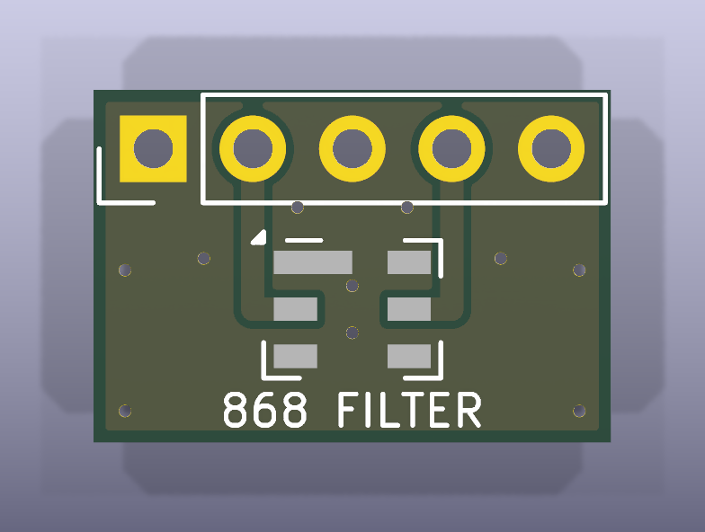

# LR2021 Node – 868 MHz filter module

A plug-in band-pass filter for socket J22 of the carrier board. It sits between the Core2021-HF and
the 868 MHz front end (SE2435L):

- **Receiving:** behind the low-noise amplifier. Strong signals outside the band – above all LTE 800
  (791–821 MHz, directly below 868 MHz) and the mobile uplink up to 862 MHz – are attenuated by
  40–45 dB before they reach the LR2021. Because the LNA comes first, the filter loss costs almost no
  sensitivity.
- **Transmitting:** in front of the power amplifier, so only the drive level (a few mW) passes the
  filter. It also removes noise and spurious signals of the radio chip before they are amplified.



| | |
|---|---|
| Filter | Qualcomm (EPCOS) B39871B3725U410, SAW, 869 MHz, usable 868.0–870.0 MHz |
| Loss | 2.5 dB typical, 3.5 dB max. (868–870 MHz) |
| Rejection | 40–45 dB below 845 MHz, 45–55 dB from 883 MHz, 35–40 dB at 1.2–2 GHz |
| Max. power | 13 dBm (18 dBm at 10 % duty cycle) – the firmware keeps the drive level below 8 dBm |
| Board | 13.2 × 9.0 mm, two layers, 1.6 mm, short coplanar lines (5 mm, about 55 Ω) |
| Footprint | KiCad `Filter_SAW_Epcos_DCC6C_3x3mm` (EPCOS app note 93, 1.2 mm pitch) |
| Connector | 1×5 pin header 2.54 mm: GND, port 1, GND, port 2, GND |

868.0–870.0 MHz covers Meshtastic EU_868 (869.525 MHz), MeshCore (869.618 MHz), the 500 mW sub-band
869.40–869.65 MHz and the LoRaWAN channels 868.1–868.5 MHz.

## Other bands

The module is the part to change when another radio module or band is used (e.g. 915 MHz): build the
same board with a SAW filter for that band in the same 3 × 3 mm package (DCC6C: input pin 2, output
pin 5, all other pins ground). Without any filter the 868 MHz path of the carrier is open – bridge
pin 2 and pin 4 of J22 with a short wire instead and set the filter loss of the front-end calibration
to 0 (`lrmodem.py fe --filter-loss 0`, see [firmware.md](../../docs/firmware.md)); the factory value
of 3 dB assumes this module.

## Ordering and assembly

1. Upload `fabrication/filter868-gerber.zip`: 2 layers, **1.6 mm**, 1 oz.
2. SMD assembly: `fabrication/bom.csv` and `fabrication/cpl.csv` (one part, FL1). Or solder FL1 by
   hand with hot air (pads are underneath the part).
3. Pin header (`fabrication/hand-solder.csv`): insert it from the **bottom** side (plastic underneath,
   long pins pointing down), solder on the top. The module then plugs into J22 with the filter facing
   up and the board pointing away from the front end; the orientation of the two ports does not
   matter (the filter works in both directions).

## Rebuild

Linux or WSL with KiCad 9:

```
python3 generate_filter.py
```
